# Buy Domain

Di Shoppego, anda kini sudah boleh lakukan pembelian domain terus di dashboard Shoppego. Bagi setiap pembelian domain di dashboard Shoppego, anda sudah tidak perlu lakukan penetapan DNS kerana ia akan automatik di lakukan oleh sistem. Anda juga boleh menguruskan penetapan DNS records anda terus melalui dashboard Shoppego.

## Pada halaman ini:

* [Lakukan pembelian domain](buy-domain.md#lakukan-pembelian-domain)
* [Pengurusan domain](buy-domain.md#pengurusan-domain)

## Lakukan pembelian domain

1. Log masuk dashboard Shoppego

<figure>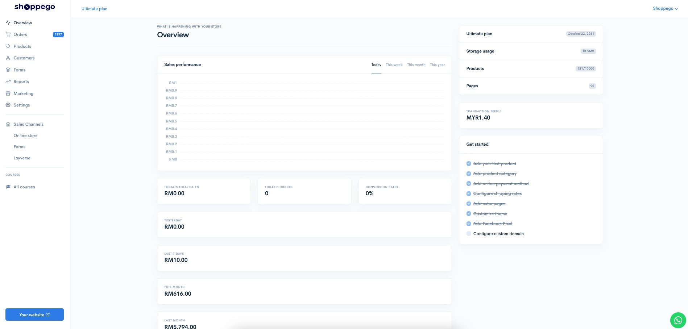<figcaption></figcaption></figure>

2. Klik pada **Settings**

<figure>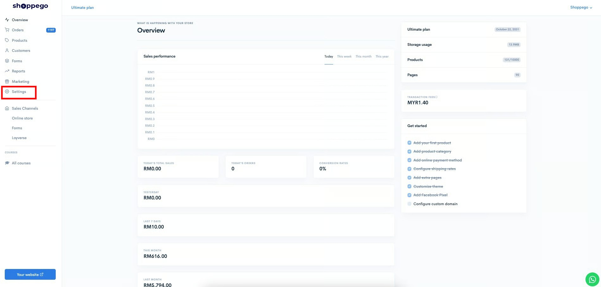<figcaption></figcaption></figure>

3. Klik pada **Custom domain**

<figure>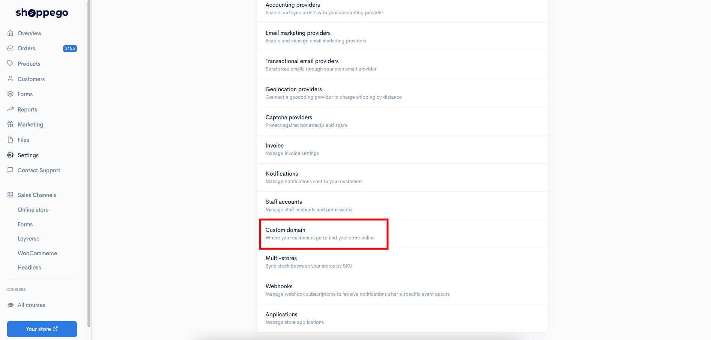<figcaption></figcaption></figure>

4. Klik pada "**Buy new domain**"

<figure>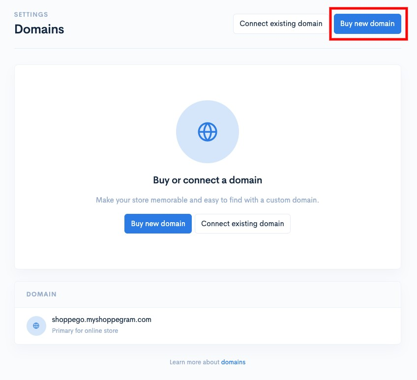<figcaption></figcaption></figure>

5. **Lakukan carian domain** **yang anda inginkan** dan klik "**Buy**" pada domain tersebut untuk lakukan pembayaran. **Nanti anda akan diminta untuk semak email bagi lakukan pengesahan dan sebagainya.**

<figure>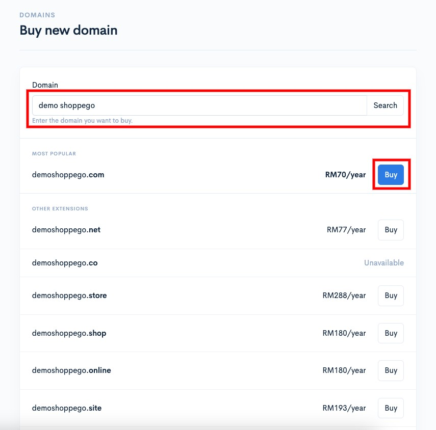<figcaption></figcaption></figure>

<figure>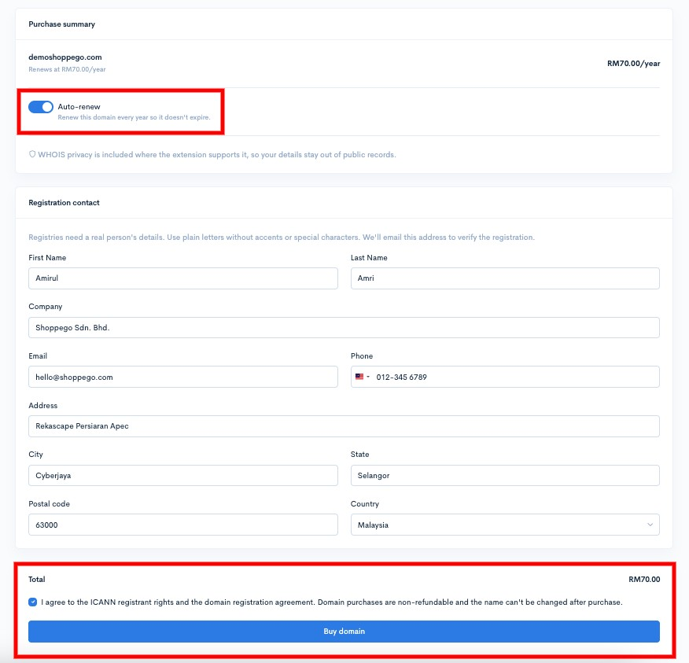<figcaption></figcaption></figure>

<figure>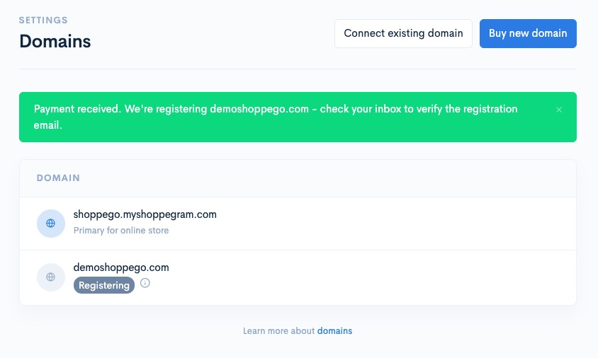<figcaption></figcaption></figure>

Kini pembelian domain anda sudah selesai.

## Pengurusan Domain

Pada halaman "**Custom domain**", anda boleh terus lakukan pengurusan domain yang anda baru beli itu.

Anda boleh klik butang "**Manage**" pada domain yang anda baru beli tersebut, nanti anda akan dapat lihat penetapan:

<figure>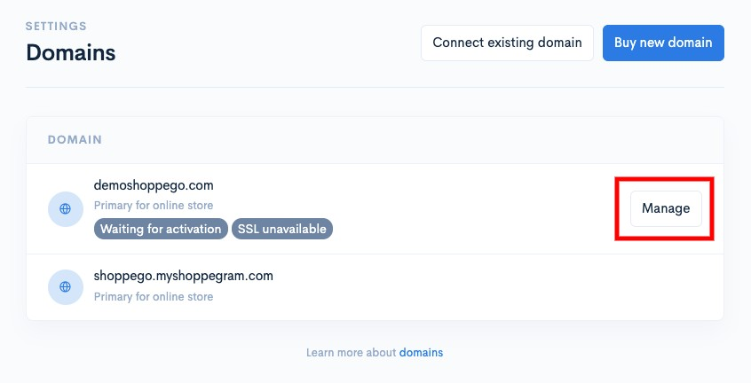<figcaption></figcaption></figure>

### Set As Redirect

Penetapan ini boleh digunakan jika anda ingin "redirect" setiap pengguna yang ingin akses URL domain anda itu ke URL website anda. Sebagai contoh, anda hanya mempunyai 1 sahaja penetapan domain, jadi jika anda menggunakan fungsi ini, mana-mana pengguna yang cuba akses domain anda itu akan "redirect" ke URL subdomain .myshoppegram.com anda.

<figure>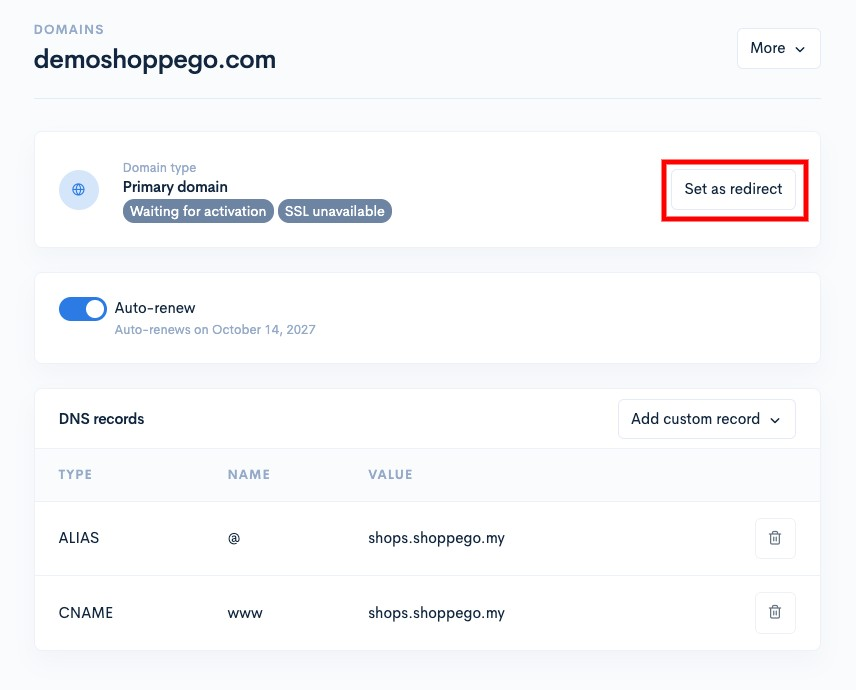<figcaption></figcaption></figure>

### Auto Renew

Anda boleh tick pada toggle ini, jika anda ingin pastikan pembayaran langganan domain anda itu dilakukan secara automatik sebelum tarikh tamat tempoh dan sebaliknya.

<figure>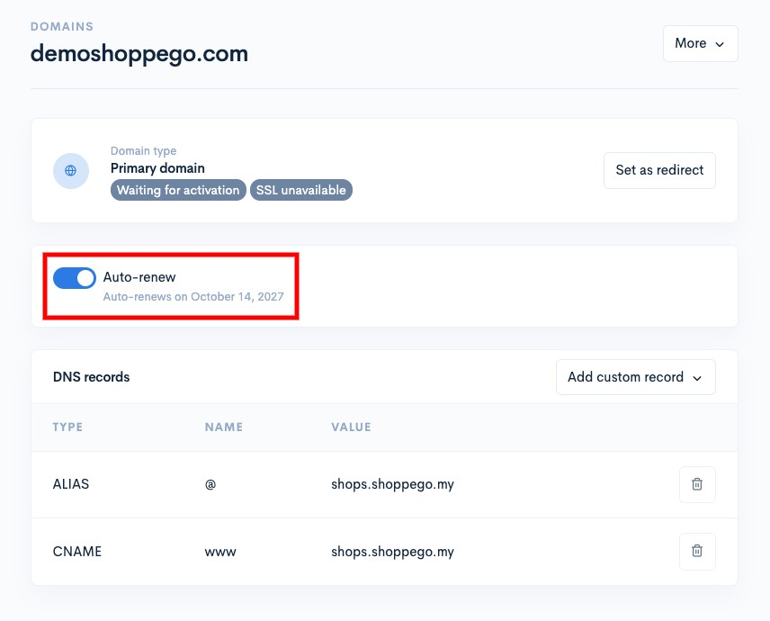<figcaption></figcaption></figure>

### Add custom record

Jika anda ingin lakukan sebarang penambahan DNS records anda yang tersendiri, anda boleh klik pada butang "**Add custom record**" dan pilih record yang anda tambah.

<figure>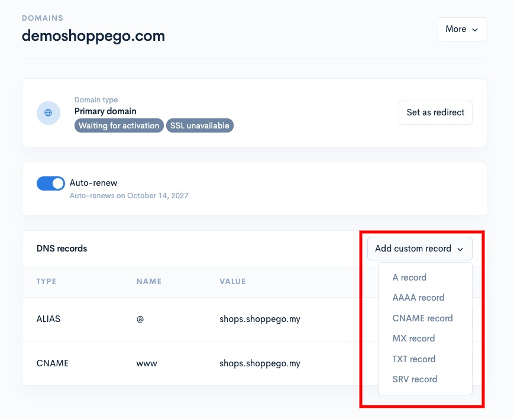<figcaption></figcaption></figure>

### Remove DNS Record

Jika anda ingin buang mana-mana DNS records yang anda tidak inginkan, anda boleh klik pada **ikon tong sampah** untuk **DNS records yang anda ingin buang** itu.

<figure>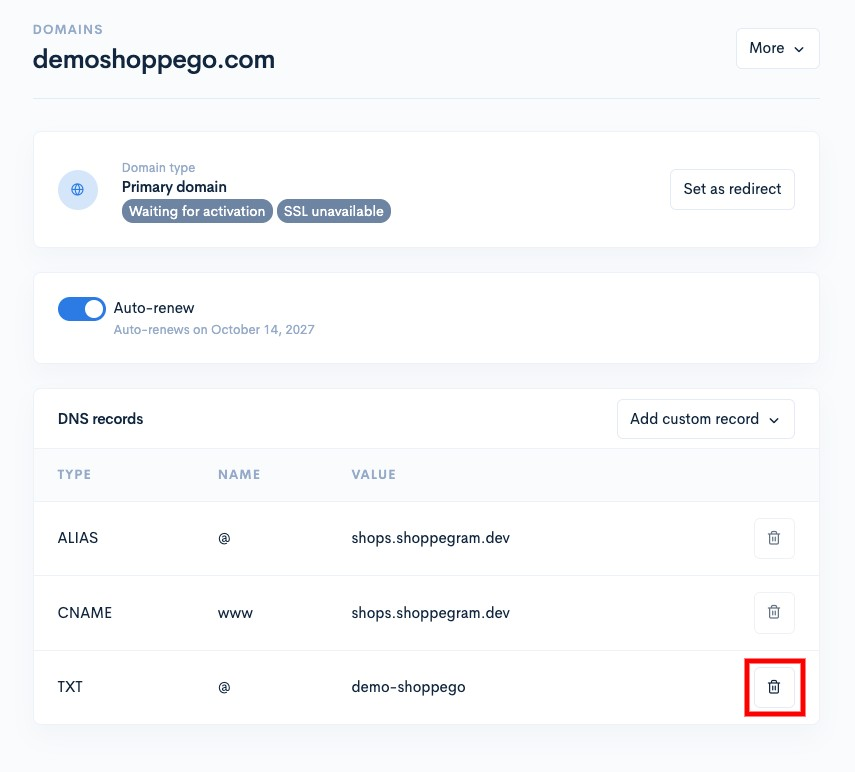<figcaption></figcaption></figure>

### Remove Domain

Jika anda tidak ingin menggunakan domain ini lagi pada penetapan store Shoppego anda itu, anda boleh klik pada butang "**More**" > "**Remove domain**" tersebut.

<figure>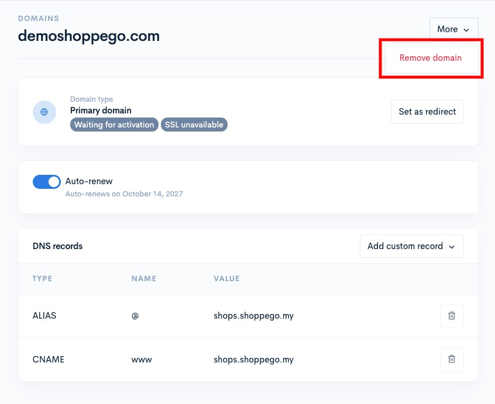<figcaption></figcaption></figure>
